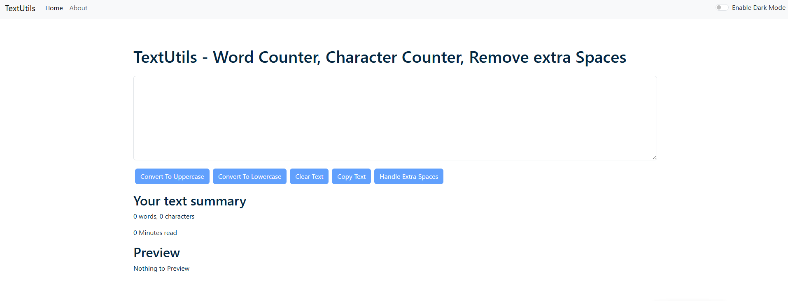
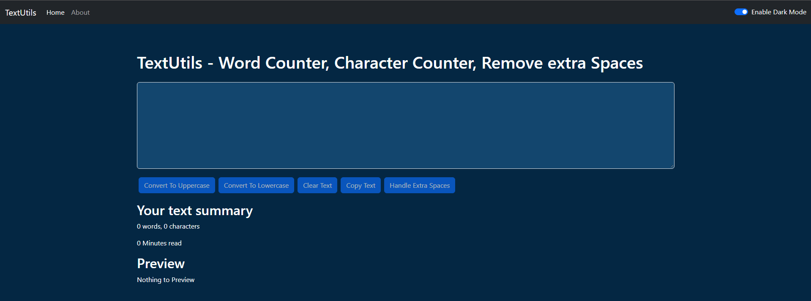
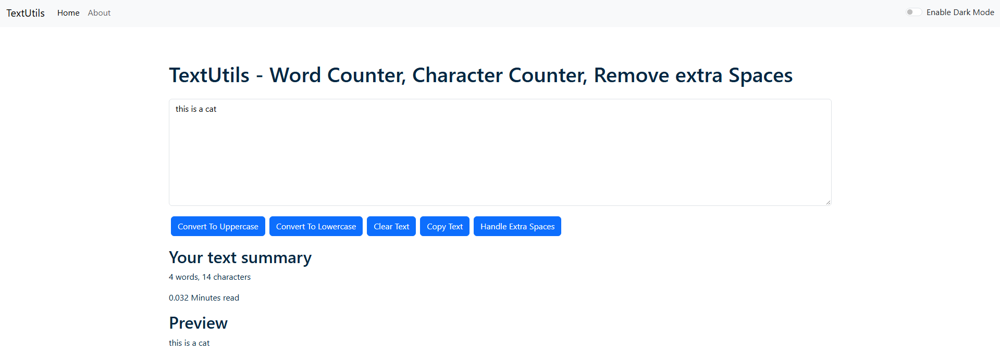
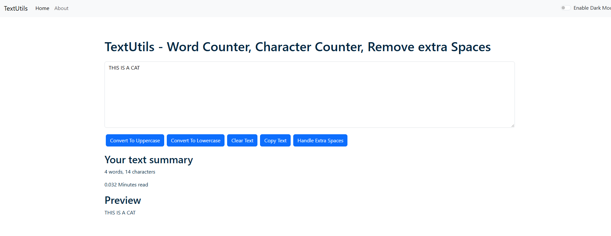

# TextUtils

A simple text utility web application built with React.js, JavaScript, Bootstrap, and CSS.

## 🌐 Live Demo

[Visit TextUtils](https://coderking202.github.io/TextUtils/)

## 📸 Screenshot

## ✨ Features

- Convert text to uppercase.
- Copy text to the clipboard.
- Simple and responsive user interface.

## 🛠️ Built With

- React.js
- JavaScript
- HTML5
- CSS3
- Bootstrap

## 🚀 Deployment

The website is hosted using **GitHub Pages**.

**Live URL:** https://coderking202.github.io/TextUtils/

## 👨‍💻 Author

**Jatin Lama**

- [GitHub](https://github.com/CoderKing202)
- [LinkedIn](https://www.linkedin.com/in/jatin-lama-84ab103bb/)
